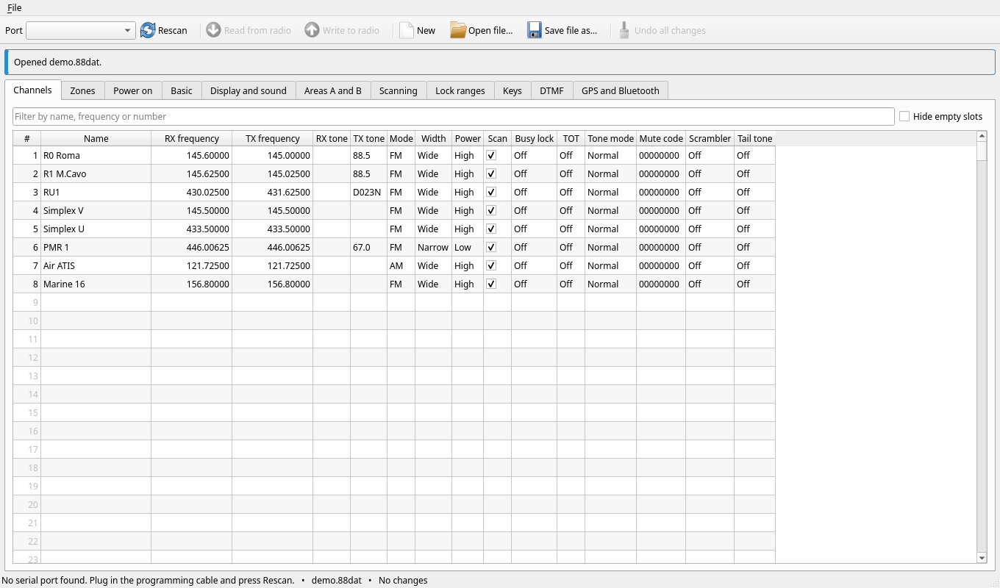

# RT-860 CPS

A desktop editor for Linux and Windows, for the memory channels, zones and settings of the **Radtel
RT-860** handheld. It does the job of Radtel's Windows programming software
(`RT-860 Radio CPS V1.06`). C++20 and Qt 6.



> **Not yet tried on a real radio.** The serial protocol and memory layout were worked
> out from Radtel's CPS V1.06, and the program is tested against a simulated radio
> only. Until someone confirms it on hardware, read your radio first, save that file
> somewhere safe, and check that what the program shows matches the radio before you
> write anything.

## What it does

- Reads the radio over the programming cable (115200 baud) and shows the 1024 memory
  channels in an editable table: name, RX and TX frequency, tones, mode, width, power,
  scan, busy lock, time-out timer, tone mode, mute code, scrambler and tail tone.
- Edits the 256 zones: name and up to 200 member channels each, in order.
- Edits the settings, grouped as Power on, Basic, Display and sound, Areas A and B,
  Scanning, Lock ranges, Keys, DTMF (with the 20 DTMF codes) and GPS and Bluetooth.
- Adds ready-made channel lists into empty slots, optionally with a zone for each:
  CB 27 MHz (FM and AM), marine VHF, PMR446, LPD433, Freenet, Italian 43 MHz, KDR444,
  FRS/GMRS, MURS, NOAA weather, amateur calling frequencies, distress frequencies and
  the tower, approach, ground and ATIS frequencies of Italian airports (three lists:
  north, centre, south and islands; data from [OurAirports](https://ourairports.com/data/),
  public domain)
- Adds Italian amateur FM repeaters, one list per region (2 m and 70 cm, with shift and
  access tone), and the amateur FM satellites and ISS with Doppler steps.
- The lists are plain CSV files in [`lists/`](lists/README.md). Keep your own in
  `~/.local/share/rt860cps/lists/` (*Open my lists folder* in the dialog): a new file adds
  a list, a file named like a shipped one replaces it.
- Flags channels whose stored data is not what the program expects.
- Opens and saves Radtel's own `.88dat` files, so files can go back and forth with the
  Windows CPS.

## How it protects the radio

- Writing is switched off until a read from the radio has succeeded in the same
  session.
- Before every write it reads the radio and saves that as a dated `.88dat` backup.
- It writes only the 1 KiB memory blocks that changed (plus the first settings block,
  which the Radtel software always sends first), then reconnects, reads the radio
  back and compares.
- If the radio changed the same memory since it was read (for example through its own
  menu), the write stops and asks.
- Bytes it does not understand are carried through unchanged.
- It never changes the radio's read/write password. See "Password" below.

## Install and build

On Debian 12+, Ubuntu 24.04+ or Raspberry Pi OS Bookworm+:

```sh
sudo apt install g++ cmake ninja-build qt6-base-dev
cmake -S . -B build -G Ninja
cmake --build build
ctest --test-dir build        # optional: runs the core tests
./build/rt860cps
```

To make packages: `cd build && cpack -G "DEB;TGZ"`.

Your user needs access to the serial port, usually by being in the `dialout` group.

### Windows

Unzip `rt860cps-<version>-windows-x64.zip` anywhere and start `rt860cps.exe`; there is
nothing to install. It needs 64-bit Windows 10 or 11 and the driver of your programming
cable, which shows up as a COM port.

The zip is built on Linux: `tools/build-windows.sh` (the script lists what it needs).

## Use

1. Connect the programming cable, switch the radio on, and press **Read from radio**.
2. **Save file as…** to keep a copy of what the radio held.
3. Edit channels (double-click a cell), zones and settings. Changed values are bold.
4. Press **Write to radio**. The program lists the changes and asks before sending.

Backups go to `~/.local/share/rt860cps/backups`; change that under
*File → Choose backup folder*. On Windows the backups and your own lists are under
`%LOCALAPPDATA%\rt860cps`.

Command line:

```sh
rt860cps file.88dat                     # open a file
rt860cps --dump /dev/ttyUSB0 out.88dat  # read the radio to a file, without a window
rt860cps --dump COM3 out.88dat          # the same on Windows
```

`--dump` only reads, so it is the safest first test with a real radio.

## Not included

Firmware flashing, the startup picture, tuning data, GPS records, FM broadcast presets,
VFO A/B and the alarm clocks. FM presets and the VFOs are read, kept and written back
unchanged.

Two settings keep the name the Radtel software uses internally because their meaning is
not clear from it: "SPTT" and "6 or 8".

## Password

Radtel's software can set a read/write password. The radio does not check it; the
Windows software does, by comparing what you type with 12 bytes it reads from the
radio. This program does not ask for it, and never changes those 12 bytes, whether the
data comes from the radio or from a file.

## How the format was found

`docs/design.md` has the serial protocol and the byte layout of channels, zones and
settings, as read from the decompiled Radtel CPS V1.06 (an unobfuscated .NET program).

## Licence

RT-860 CPS is free software under the GNU General Public License, version 3 or later.
See [LICENSE](LICENSE). It is not affiliated with Radtel. Use it at your own risk: it
writes to your radio's memory.
